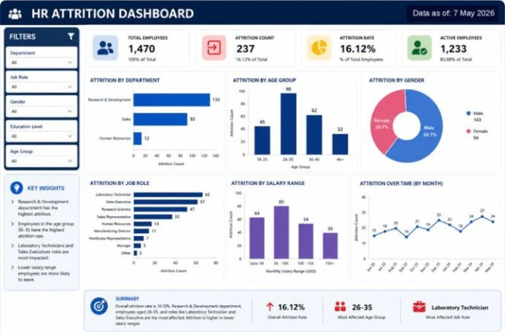

# ATTRITION-RATE 
THE ANALYSIS IS ON ATTRITION 
## Dashboard Preview

Employee Attrition Analysis – McMoren Logistics

Project Overview

Analyzed employee attrition data to uncover patterns and identify key factors contributing to employee turnover at McMoren Logistics.

The goal was to transform raw data into actionable insights that could help the organization improve employee retention and make informed workforce decisions.

Tools & Technologies

- Microsoft Excel: Data cleaning and preparation
- Power BI: Data visualization and interactive dashboard development

Project Process

1. Cleaned and prepared the dataset using Microsoft Excel.
2. Explored key employee attributes, including department, job role, salary, and age demographics.
3. Analyzed attrition patterns across different employee categories.
4. Developed interactive Power BI dashboards to visualize trends and communicate findings.

Key Insights

1. Departmental Impact

The Research & Development department recorded the highest employee attrition, followed by Sales.

2. Age Demographics

Employees within the 26–35 age group experienced the highest attrition, highlighting a potential need for improved mid-career engagement and development opportunities.

3. Critical Job Roles

Laboratory Technicians and Sales Executives were the most affected job roles in terms of employee attrition.

4. Salary Correlation

Higher attrition was observed among employees within the lower-to-mid salary ranges, suggesting that compensation may be an important factor influencing employee retention.

Business Recommendations

Based on the findings, the organization could consider:

- Reviewing workplace culture and employee satisfaction within high-attrition departments.
- Evaluating compensation structures for affected job roles.
- Introducing career development and progression opportunities for younger employees.
- Strengthening employee engagement and retention strategies.

Project Impact

The analysis demonstrates how data analytics can help organizations identify workforce challenges, understand employee turnover patterns, and develop data-driven strategies to improve employee retention.

Key Takeaway

Data tells a story. With proper cleaning, analysis, and visualization, raw data can be transformed into meaningful insights that support smarter business decisions.
